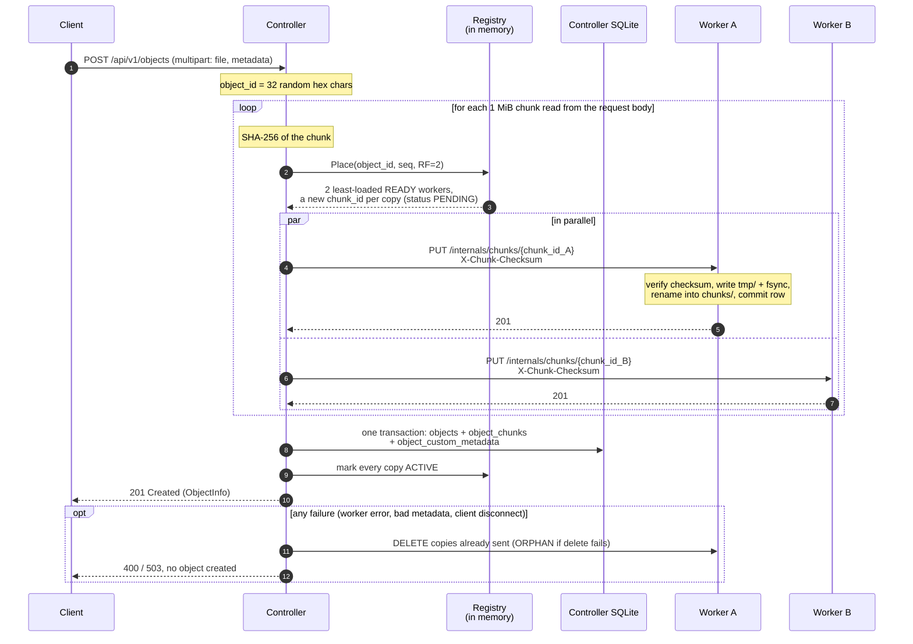
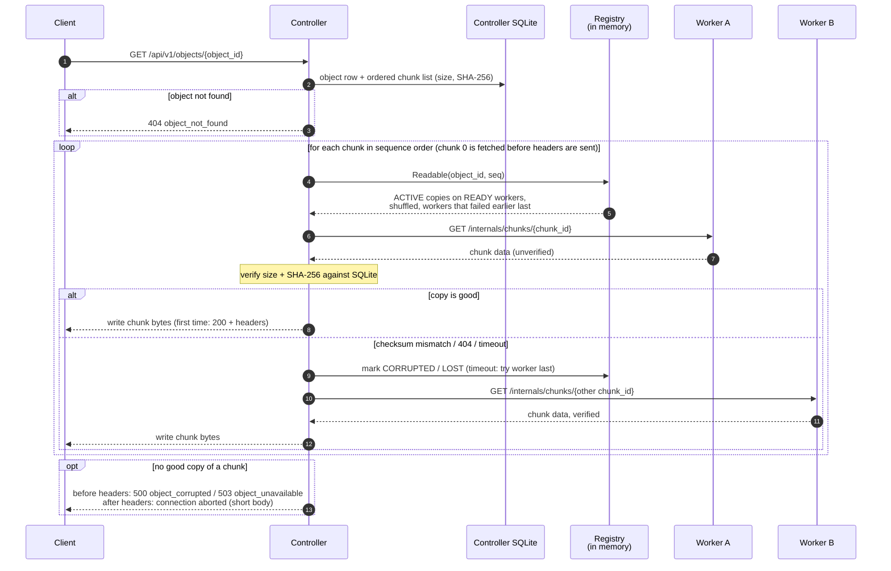
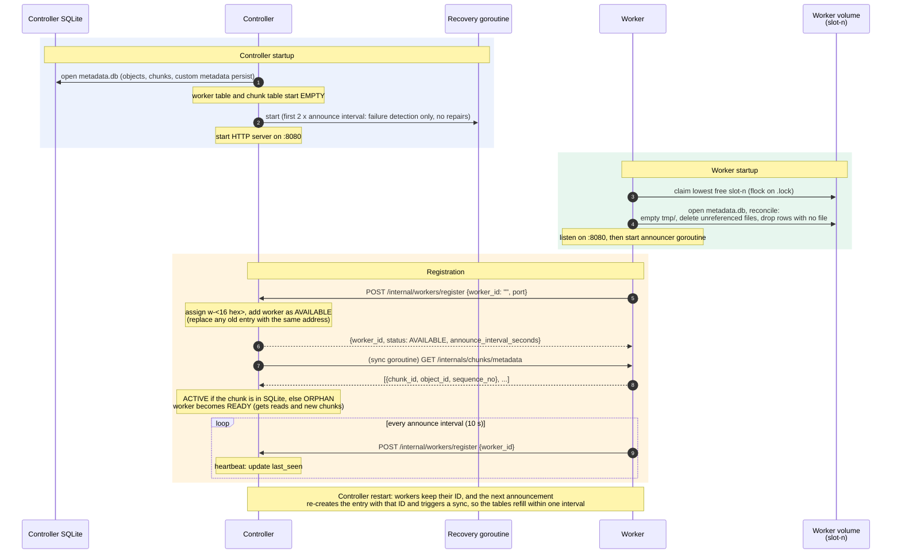
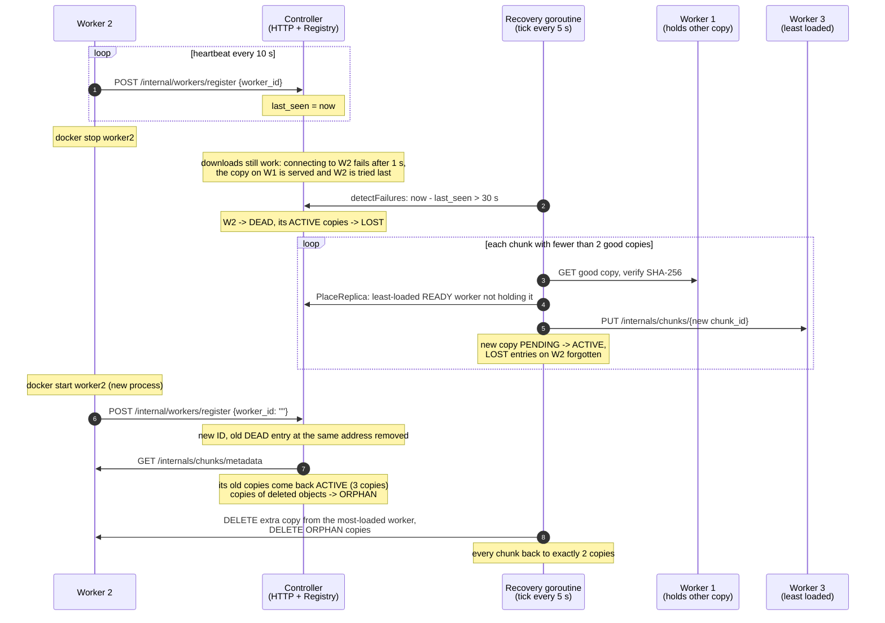
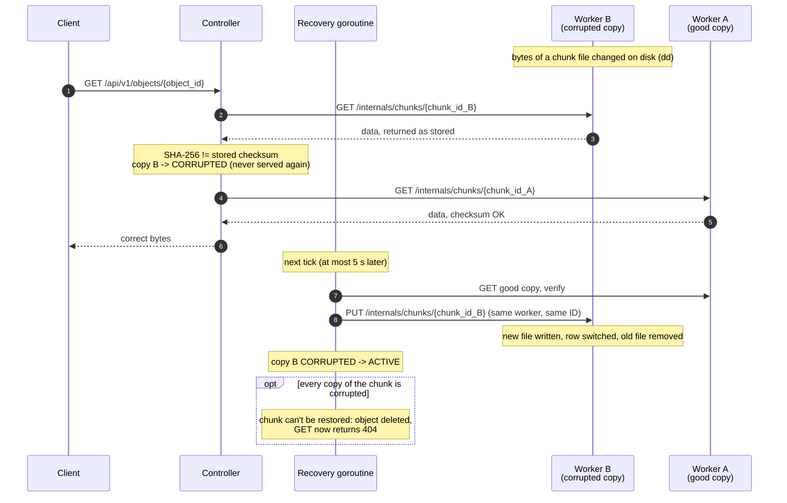

# Mini Distributed Cloud Object Store: Project Report

| Contributor | Roll number |
|---|---|
| Sahas Sangal | IMT2023556 |
| Suryans Dash | IMT2023041 |

This report covers the design decisions and behaviour of our implementation. The problem statement, the required system configuration and the required APIs are in `Mini_Distributed_Cloud_Object_Store.pdf` and are not repeated here.

**Stack:** Go controller and workers, SQLite (pure-Go driver) for persistent metadata, React + Vite web GUI, Docker Compose (1 controller + 4 workers, scalable with `--scale worker=N`).

---

## 1. Persistent data

### 1.1 Controller: `DATA_DIR/metadata.db` (SQLite on the `controller-data` volume)

| Table | Columns | Purpose |
|---|---|---|
| `objects` | `object_id` (PK), `name`, `content_type`, `size`, `checksum` (SHA-256 of the whole object), `chunk_count`, `created_at`, `updated_at` | System metadata of each object |
| `object_chunks` | `object_id`, `sequence_no` (PK together), `size`, `checksum` (SHA-256 of the chunk) | Ordered chunk list and the reference checksum for each chunk |
| `object_custom_metadata` | `object_id`, `key` (PK together), `value` | User key/value metadata |

- **Why:** these facts don't change while the object exists. The per-chunk checksum is what lets the controller verify every copy it reads, so it is the system's only source of truth for integrity.
- **What is *not* persisted, and why:** chunk locations and worker IDs. Workers come and go, and copies get lost or corrupted, so a stored location would soon be stale. Locations are rebuilt at runtime from what the workers report (§2).

### 1.2 Worker: one `slot-<n>/` directory on the shared `worker-data` volume

```text
slot-<n>/
├── .lock         flock held by the worker that owns this slot
├── metadata.db   SQLite: chunks(chunk_id PK, object_id, sequence_no, file_path, size, created_at)
├── chunks/       one file per chunk copy: <chunk_id>.<random>
└── tmp/          writes in progress
```

- **Why:** after a restart the worker must be able to tell the controller exactly which chunks it can serve. The SQLite table is that list, and the reconciliation keeps it true. Slots let identical, scaled replicas of the `worker` service share one volume: each restarted or newly added container claims a free slot, together with its chunks.

---

## 2. Runtime state on the controller (in memory)

Both tables live in `cluster.Registry`, behind one lock so they always agree.

| Table | Key → value | Why |
|---|---|---|
| **Worker table** | `worker_id` → address, status, chunk count, `last_seen` | Placement (least-loaded `READY` workers), failure detection (`last_seen`) and reads (address) |
| **Chunk (replica) table** | `chunk_id` → `object_id`, `sequence_no`, `worker_id`, status | Where each copy is and whether it is usable. Indexed by object and by worker. |

Every copy has its own random `chunk_id`, so the two copies of a chunk can be tracked separately. Both tables are rebuilt from worker registrations and chunk reports. They are empty after a controller restart and refill within one announce interval.

**Worker status**

| Status | Meaning | Purpose |
|---|---|---|
| `AVAILABLE` | Registered; the controller is still loading its chunk list | Gets no new chunks, and nothing is deleted on its behalf, because it may still report a good copy |
| `READY` | Chunk list loaded | Serves reads and receives new chunks |
| `DEAD` | No heartbeat for `WORKER_DEAD_AFTER` (30 s) | Excluded from reads and placement; its copies become `LOST` |

**Copy (replica) status**

| Status | Meaning | Purpose |
|---|---|---|
| `PENDING` | Being written by an upload or by recovery | Not readable. Recovery skips the chunk, so an in-flight upload isn't "repaired". |
| `ACTIVE` | Committed and readable | The only status that is served |
| `CORRUPTED` | Failed the size/SHA-256 check on a read | Never served again; recovery rewrites it in place |
| `LOST` | Its worker is `DEAD`, or the worker answered 404 | Recovery restores the copy. If the worker comes back, the copy may return. |
| `ORPHAN` | On a worker but owned by no object (failed upload or delete, delete while the worker was down) | Recovery deletes it to reclaim space |

Design rule: **events only change a status**, and the recovery goroutine (§4) reacts to it. A missed heartbeat, a failed checksum or a 404 just flips a status, so all repair logic lives in one place.

---

## 3. Workflows

The `.mmd` sources are in `docs/diagrams/`.

### 3.1 Upload



The controller streams the body through one reusable 1 MiB buffer, so memory use doesn't grow with object size. Each chunk goes to the 2 `READY` workers with the fewest copies, with ties broken at random. This rotates consecutive chunks across all workers. Metadata is committed only after all copies are stored, so a failed upload leaves no partial object. With fewer than 2 `READY` workers the upload is refused with `503 insufficient_workers`.

### 3.2 Download



The client never sees worker locations. Chunks are fetched and written one at a time, and every copy is verified before a single byte of it reaches the client, so corrupted data is never returned while a good copy exists. Chunk 0 is fetched before the `200` is sent, so most errors can still be reported with a proper status code.

### 3.3 Startup of the controller and a worker



The controller has no static worker list. Workers find it through `CONTROLLER_URL` and register themselves. The controller records the worker's address from the request's source IP, so it talks to each container directly. The worker ID is assigned by the controller and lives only as long as the worker process. The worker binds its port *before* registering, because the controller immediately calls back for the chunk list. The recovery job waits for a startup grace period after a controller restart. Without it, chunks whose copies just haven't been re-reported yet would look under-replicated and be copied needlessly.

### 3.4 Worker failure: detection and recovery



**Heartbeat mechanism.** There is no separate heartbeat endpoint or controller-side ping. Each worker's announcer goroutine re-sends `POST /internal/workers/register` with its ID every `ANNOUNCE_INTERVAL` (10 s in compose), and the controller only updates `last_seen`. The interval is set by the controller: it is returned in every register response and the worker adopts it, so both sides agree. The push model keeps the controller passive: it needs no worker list and opens no connection per worker per interval.

**Detection.** On every tick (5 s), the recovery goroutine declares `DEAD` any worker whose `last_seen` is older than `WORKER_DEAD_AFTER` (30 s, three missed heartbeats). That worker's `ACTIVE` copies become `LOST`. Detection therefore takes 30–35 s. Reads don't wait for it: a dead worker's connection fails after 1 s, the other copy is served, and that worker is tried last for the rest of the download.

**Recovery.** In the same tick, every chunk left with fewer than 2 good copies is read from a surviving copy, verified, and copied to the least-loaded `READY` worker that doesn't already hold it. **Restart:** the restarted worker gets a new ID and replaces the stale entry at its address. Its chunks on disk are reported again, so those chunks briefly have 3 copies. Recovery deletes the extra copy from the most-loaded worker. If **both** holders of a chunk are down, the object is *kept* (downloads answer `503`, the dashboard shows "unavailable") until one of them returns.

### 3.5 Chunk corruption



Corruption is detected by the controller when it reads a copy, during a download or when recovery reads a copy as a source. The bad copy is skipped and marked, and the client still receives correct bytes. The copy is then **repaired in place**: same worker, same `chunk_id`, rewritten from the good copy. A chunk whose every copy is corrupted can't be restored, so its object is deleted and the deletion is logged.

---

## 4. Goroutines

### Controller

| Goroutine | Count | Purpose |
|---|---|---|
| HTTP server | 1 listener + 1 per request (`net/http`) | Client API, internal API, dashboard API |
| **Recovery job** | **1, long-lived** | All failure handling (below) |
| Chunk-list sync | 1 per new, revived or moved worker; short-lived | `GET /internals/chunks/metadata`, classifies each copy as `ACTIVE`/`ORPHAN`, then marks the worker `READY`. Runs in the background, so the register call returns immediately. |

**Recovery goroutine.** This is a single loop on a `RECOVERY_INTERVAL` (5 s) ticker. Each tick it:
1. **Detects failures:** workers silent longer than `WORKER_DEAD_AFTER` become `DEAD`, and their copies become `LOST`. This step runs even during the startup grace period.
2. **Checks every chunk in SQLite** against its copies in the chunk table:
   - a `CORRUPTED` or `LOST` copy on a `READY` worker, with a good copy available: **rewrite it in place**;
   - fewer than RF good copies: **copy to the least-loaded `READY` worker**, then forget the `LOST` entries on dead workers;
   - more than RF good copies: **delete the extra copy from the most-loaded worker**;
   - no good copy, but a copy on a `DEAD` worker: **wait** (chunk "unavailable");
   - every copy corrupted or missing: **delete the object**.
3. **Deletes `ORPHAN` copies** from `READY` workers.
4. Publishes a summary (degraded, unavailable and orphan counts) for the dashboard.

Safety rules: a chunk with a `PENDING` copy is skipped, nothing is declared lost while a worker is still `AVAILABLE` (syncing), and no repairs run during the startup grace period. A healthy chunk costs **zero** worker requests, because copies are read only when something needs to be written. We chose one goroutine so that repairs never race each other and the whole policy is in one place.

### Worker

| Goroutine | Purpose |
|---|---|
| HTTP server (+1 per request) | Chunk API, `/healthz`, `/dashboard/stats` |
| **Announcer** | Registers at startup, then re-announces every interval (the heartbeat). Adopts the controller's interval. Retries with exponential back-off (2 s up to the interval) while the controller is down. Stops if the controller answers `410 worker_retired` (deregistered). |

---

## 5. Deviations from the API in the problem statement

| Problem statement | Our implementation | Reason |
|---|---|---|
| `POST /internal/workers/heartbeat` | **None.** A periodic re-`register` with the worker's ID is the heartbeat. | One endpoint handles join, re-join after a controller restart, and liveness. The response carries the announce interval. |
| `GET /internal/workers/{worker_id}/chunks` (on the controller) | **Worker** serves `GET /internals/chunks/metadata`; the controller **pulls** it after registration | The worker's disk is the source of truth for what it holds, so the controller rebuilds its chunk table from the workers. |
| `PUT/GET/DELETE /internal/chunks/{chunk_id}` | `/internals/chunks/{chunk_id}` on the worker. Body is JSON `{object_id, sequence_no, data(base64)}` plus an `X-Chunk-Checksum` header. | Each copy carries its owner and position, so a worker can report and reconcile its chunks without the controller. The header catches transfer damage. |

All errors are JSON `{"error": {"code", "message"}}`. Codes include `object_not_found`, `insufficient_workers`, `object_unavailable` and `object_corrupted`.

---

## 6. Build and run

Requirements: Docker with Compose v2. For the GUI, also Node.js 20+. Go 1.26+ is needed only to run tests or run without Docker.

```sh
docker compose up --build -d          # controller on :8080 + 4 workers
docker compose ps                     # wait until all are (healthy)
curl -s localhost:8080/internal/workers

# Web GUI (proxies /api and /dashboard to the controller on :8080)
cd client && npm install && npm run dev     # open http://localhost:5173

docker compose up -d --scale worker=6       # scale workers
docker compose down                         # keep data;  `down -v` wipes volumes
```

Tests: `cd controller && go test -race ./...` and `cd worker && go test -race ./...`. Postman collections for both APIs are in `postman_collection_integerationTesting/`. Worker containers are named `distributedobjectstorage-worker-<n>`, so the failure demo is `docker stop distributedobjectstorage-worker-2` and `docker start distributedobjectstorage-worker-2`.

---

## 7. Demonstrating the system with the web GUI

The GUI has two tabs, **Objects** and **Dashboard**. Together they cover every required demonstration:

- Upload files (optionally with custom key/value metadata), then download or delete them, with progress shown for each transfer.
- See every object's name, type, size, chunk count, object ID, SHA-256 and creation time.
- Open an object to see its system metadata, and edit its name, content type and custom metadata without re-uploading.
- See each chunk's two copies, which worker holds each copy, and the copy's status (`ACTIVE`, `CORRUPTED`, `LOST`, …).
- See cluster health at a glance: workers ready, data health (healthy, degraded or unavailable chunks), object count, chunk copies and cluster load.
- See a card for each worker with its status (`READY`, `AVAILABLE`, `DEAD`), chunk count, stored bytes and request rate.
- Watch live charts of requests per worker and of chunk copies per worker (the even spread).
- Watch each worker's time since its last heartbeat, which goes stale when a worker is stopped.
- Follow a live activity feed of events, such as `worker_dead`, `replica_corrupted`, `replica_restored`, `replica_repaired` and `replica_trimmed`.

---

## 8. Current limitations

1. **The controller is a single point of failure.** Its worker and chunk tables are in memory. After a controller restart they are empty until every worker re-announces (up to one interval), and `CORRUPTED` marks are forgotten. While the controller is down, nothing can be uploaded or downloaded.
2. **Corruption is found only on read.** There is no background scrubbing. A rarely read chunk can silently lose both copies, and then the object is unrecoverable.
3. **Slow failure detection and no rebalancing.** For 30 s after a worker stops it is still `READY`, so new uploads may be placed on it and fail with `503 worker_unavailable` (reads are not affected). Separately, existing chunks never move: a newly added worker only receives new chunks, so load stays uneven until enough new data arrives.

---

## 9. Future scope

**Rebalancing when a new worker joins.** Add a rebalance step to the existing recovery goroutine rather than a new goroutine (design notes: `docs/phase6_rebalancing_notes.md`):
- after the repair pass, compare the `READY` workers' copy counts;
- while the spread between the most and least loaded worker is above a threshold, move one copy of a *fully healthy* chunk from the most-loaded to the least-loaded worker;
- move **copy first, delete last** (place, read and verify, `PUT`, mark `ACTIVE`, then delete the old copy), so a chunk never drops below RF;
- move at most *N* chunks per tick, so client traffic isn't starved;
- skip the step while any worker is syncing and during the startup grace period.

**Multiple controllers.** Removes limitation 1.
- **Replicated metadata:** move the object and chunk metadata from local SQLite to a replicated store. This could be a Raft group among the controllers (e.g. `hashicorp/raft` with SQLite as the state machine) or an external etcd or Postgres cluster.
- **Leader election:** one leader (Raft or an etcd lease) handles writes and runs the single recovery goroutine, so repairs never conflict. Followers can serve downloads and metadata reads.
- **Warm standby:** workers announce to every controller (or to a virtual IP / load balancer). Because the worker and chunk tables are already rebuilt from worker reports, every controller keeps a warm copy and a new leader can take over without the startup grace period.
- **Clients:** they reach the controllers through a load balancer. Followers either forward writes to the leader or answer with a redirect.
