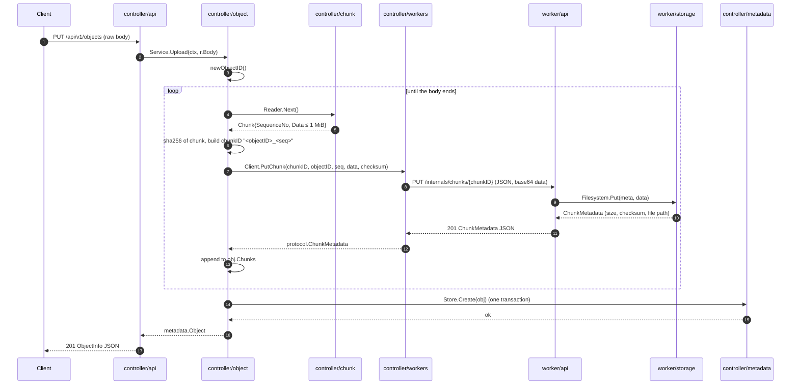
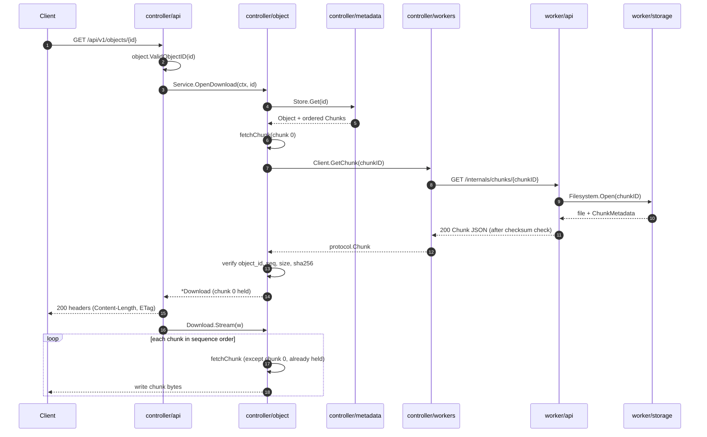

# Control Flow: PUT and GET (Phase 2)

This document traces what happens inside the code when a client uploads (PUT) or downloads (GET) an object. Each step names the **module** (Go package) and the **function** that runs, so you can see what each module is responsible for.

Function names are written as `package.Type.Method` (for example `object.Service.Upload`), or `package.Function` for plain functions. All controller packages are under `controller/internal/`, and all worker packages are under `worker/internal/`.

---

## 1. Module duties at a glance

| Service | Module | Duty | Does NOT do |
|---|---|---|---|
| Controller | `api` | Speaks HTTP to the client: routing, reading path values, choosing status codes, writing JSON errors, logging. | Chunking, talking to the worker, or touching the database. |
| Controller | `object` | The orchestrator. Runs the upload and download algorithms, generates object IDs, verifies checksums, cleans up after failed uploads. | Anything HTTP-specific (it never sees a status code). |
| Controller | `chunk` | Cuts a byte stream into numbered 1 MiB chunks using one reusable buffer. | Knowing where chunks go. |
| Controller | `workers` | HTTP client for the worker's internal API. Builds requests and turns worker responses into Go errors (`ErrUnavailable`, `ErrChunkNotFound`, `ErrChunkCorrupted`). | Deciding what to do about those errors. |
| Controller | `metadata` | Stores and reads object and chunk records in SQLite (`objects` and `object_chunks` tables). | Any chunk data. |
| Controller | `config` | Reads environment variables once at startup. | Anything at request time. |
| Shared | `pkg/protocol` | Wire types (`Chunk`, `ChunkMetadata`, `ObjectInfo`, `ErrorResponse`), header names, error codes, chunk size. | Logic. It is just shared definitions. |
| Worker | `api` | Worker's HTTP layer: validates chunk requests, verifies checksums, maps storage errors to status codes. | Files or SQL. |
| Worker | `storage` | Writes chunk files to disk durably and keeps the worker's chunk table in SQLite. | HTTP. |
| Worker | `config` | Reads the worker's environment variables. | Anything at request time. |

The layering rule: **each module only calls the module directly below it.**

```text
Client
  │  HTTP  (public API, port 8080)
  ▼
controller/api ──► controller/object ──┬──► controller/chunk
                                       ├──► controller/metadata ──► SQLite (controller volume)
                                       └──► controller/workers
                                               │  HTTP  (internal API, Docker network)
                                               ▼
                                         worker/api ──► worker/storage ──► files + SQLite (worker volume)
```

`object` depends on two small interfaces it defines itself, `object.ChunkStore` and `object.MetadataStore`, not directly on the `workers` and `metadata` packages. `main.go` plugs the real implementations in. This is what lets the tests swap in fakes.

---

## 2. Startup: how the pieces get wired together

Nothing below runs per request. It happens once when the container starts.

### Controller: `controller/cmd/controller/main.go`

| Step | Module.Function | What happens |
|---|---|---|
| 1 | `main.run` | Entry point after `main` creates a JSON logger. |
| 2 | `config.Load` | Reads `PORT`, `DATA_DIR`, `WORKER_URL`, `WORKER_TIMEOUT`, applies defaults and validates them. |
| 3 | `metadata.Open` | Creates `DATA_DIR` if needed, opens `metadata.db` (WAL mode, `synchronous=FULL`, foreign keys on) and creates the tables if they don't exist. |
| 4 | `workers.NewClient` | Builds the HTTP client pointed at `WORKER_URL` (in Docker this is `http://worker1:8080`). |
| 5 | `object.NewService` | Creates the orchestrator, giving it the worker client (as a `ChunkStore`), the metadata store (as a `MetadataStore`) and the chunk size `protocol.DefaultChunkSize`. |
| 6 | `api.NewServer` then `api.Server.Handler` | Creates the HTTP layer and registers routes. The handler chain is `recoverPanics` → `logRequests` → `ServeMux`. |
| 7 | `http.Server.ListenAndServe` | Starts accepting connections. |
| 8 | On SIGTERM: `http.Server.Shutdown`, then the deferred `metadata.Store.Close` | Finishes in-flight requests (up to 8 seconds), then closes the database. |

### Worker: `worker/cmd/worker/main.go`

| Step | Module.Function | What happens |
|---|---|---|
| 1 | `config.Load` | Reads `WORKER_ID`, `PORT`, `DATA_DIR`, `MAX_CHUNK_BYTES`. |
| 2 | `storage.NewFilesystem` | Creates `chunks/` and `tmp/`, opens `metadata.db` and creates the `chunks` table. |
| 3 | `storage.Filesystem.reconcile` | Startup cleanup: empties `tmp/`, drops rows whose file is missing, deletes files no row points to. |
| 4 | `api.NewServer` then `api.Server.Handler` | Registers `/internals/chunks/...` routes and `/healthz`. |
| 5 | `http.Server.ListenAndServe` | Starts serving. |

Docker Compose starts the controller only after the worker's health check (`GET /healthz`) passes (`depends_on: condition: service_healthy`).

---

## 3. PUT: uploading an object

```text
curl -T file.bin http://localhost:8080/api/v1/objects
```

### 3.1 Overview diagram



### 3.2 Step by step

**Controller: HTTP layer (`controller/internal/api`)**

| Step | Module.Function | What happens |
|---|---|---|
| 1 | Go's `net/http` server | Parses the request line and headers. The body is not read yet; it stays in the TCP socket. |
| 2 | `api.Server.recoverPanics` | Wraps the request so a panic becomes a JSON 500 instead of a crash. |
| 3 | `api.Server.logRequests` | Starts a timer and wraps the `ResponseWriter` in `statusRecorder` so the status and byte count can be logged at the end. |
| 4 | `ServeMux` | Matches `PUT /api/v1/objects` and calls `api.Server.handleUpload`. |
| 5 | `api.Server.handleUpload` | Calls `object.Service.Upload(r.Context(), r.Body)`. The handler passes the body through as an `io.Reader` and never reads it itself. |

**Controller: orchestration (`controller/internal/object`)**

| Step | Module.Function | What happens |
|---|---|---|
| 6 | `object.newObjectID` | Generates 16 random bytes and returns them as 32 hex characters. |
| 7 | `object.Service.Upload` | Sets up a deferred cleanup: if the function returns an error, `removeChunks` will run. Creates a whole-object SHA-256 hasher and a chunk reader. |
| 8 | `chunk.NewReader` | Allocates one 1 MiB buffer. This is the only large allocation for the whole upload. |

**Loop, once per chunk:**

| Step | Module.Function | What happens |
|---|---|---|
| 9 | `chunk.Reader.Next` | Reads from the request body until the buffer is full or the body ends. Returns `Chunk{SequenceNo, Data}`. Returns `io.EOF` when the body ended cleanly, or the underlying error if the client disconnected. |
| 10 | `object.Service.Upload` | Feeds the data into the whole-object hasher, computes the chunk's SHA-256 and builds the chunk ID `<objectID>_<seq>`. Adds the chunk ID to the `sent` list **before** calling the worker, because if the response is lost the worker might still have stored it. |
| 11 | `workers.Client.PutChunk` | Builds a `protocol.Chunk` JSON body (`object_id`, `sequence_no`, base64 `data`), sets the `X-Chunk-Checksum` header and sends `PUT /internals/chunks/{chunkID}` with a per-request timeout (`WORKER_TIMEOUT`). |

**Worker: handling the chunk (`worker/internal/api`, `worker/internal/storage`)**

| Step | Module.Function | What happens |
|---|---|---|
| 12 | `api.Server.handlePutChunk` (worker) | Reads the whole body, capped by `http.MaxBytesReader` (about 1.4 MiB for 1 MiB of base64 data). |
| 13 | `api.Server.chunkID` (worker) | Validates the chunk ID with `storage.ValidChunkID` (`^[A-Za-z0-9_-]{1,128}$`, and not `metadata`). |
| 14 | `api.Server.handlePutChunk` | `json.Unmarshal` into `putChunkRequest`. Checks `object_id`, `sequence_no` and `data`, and that data ≤ `MAX_CHUNK_BYTES`. |
| 15 | `api.sha256Hex` and `api.digestsEqual` | Hashes the data and compares it with `X-Chunk-Checksum`. A mismatch returns `400 checksum_mismatch` and nothing is written. |
| 16 | `storage.Filesystem.Put` | Validates the chunk ID again, then calls `writeChunkFile`. |
| 17 | `storage.Filesystem.writeChunkFile` | Creates a temp file in `tmp/`, copies data into it while hashing, `fsync`s it, renames it into `chunks/<chunkID>.<random>` and `fsync`s the directory. After this the bytes are durable on disk. |
| 18 | `storage.Filesystem.upsert` | In one SQLite transaction, reads any old file path for this chunk ID, then inserts or updates the row (`chunk_id`, `object_id`, `sequence_no`, `file_path`, `size`, `checksum`, `created_at`). |
| 19 | `storage.Filesystem.Put` | If the chunk overwrote an older version, removes the old file. Returns the full `ChunkMetadata`. |
| 20 | `api.Server.handlePutChunk` | Double-checks that storage recorded the same size and checksum, sets `X-Chunk-Checksum`, and replies `201` with `protocol.ChunkMetadata` JSON built by `toWireMetadata`. |

**Controller: back from the worker**

| Step | Module.Function | What happens |
|---|---|---|
| 21 | `workers.Client.PutChunk` | Requires status `201`, decodes the `ChunkMetadata`, and checks that the returned checksum header, chunk ID, object ID and sequence number all match what was sent. Any mismatch is treated as `ErrUnavailable`. |
| 22 | `object.Service.Upload` | Adds the size to `obj.Size` and appends a `metadata.Chunk{SequenceNo, ChunkID, Size, Checksum}` to `obj.Chunks`. Goes back to step 9. Because the next chunk is only read now, a slow worker also slows the client down (TCP backpressure). |

**After the last chunk:**

| Step | Module.Function | What happens |
|---|---|---|
| 23 | `object.Service.Upload` | Finishes the whole-object SHA-256 (it becomes the ETag) and sets `CreatedAt`. |
| 24 | `metadata.Store.Create` | One SQLite transaction: inserts the `objects` row, then one `object_chunks` row per chunk, then commits. Until this commit, the object does not exist for any GET. |
| 25 | `api.Server.handleUpload` | Sets `Location: /api/v1/objects/<id>` and `ETag`, then writes `201` with `protocol.ObjectInfo` JSON via `api.writeJSON`. |
| 26 | `api.Server.logRequests` | Logs method, path, status, bytes and duration. |

### 3.3 When the upload fails

| Failure | Where it is detected | What happens next | Client sees |
|---|---|---|---|
| Client disconnects or sends fewer bytes than `Content-Length` | `chunk.Reader.Next` returns the body's read error | `Upload` wraps it as `object.ErrIncompleteUpload` | `400 upload_incomplete` (usually nobody is listening any more) |
| Worker unreachable, times out or returns 5xx | `workers.Client.PutChunk` via `transportError` or `responseError` | Returns an error wrapping `workers.ErrUnavailable` | `503 worker_unavailable` |
| Metadata commit fails | `metadata.Store.Create` | Transaction rolls back, so no partial rows | `500 internal_error` |

In every case, the cleanup runs in this order:

1. **`object.Service.Upload`'s deferred function** sees the error and calls `object.Service.removeChunks` with every chunk ID in `sent`.
2. **`object.Service.removeChunks`** uses `context.WithoutCancel` so cleanup still runs after the client has gone, with a 10-second limit. It calls `workers.Client.DeleteChunk` for each chunk. On the worker, that reaches `api.Server.handleDeleteChunk` → `storage.Filesystem.Delete`, which deletes the row and then the file.
3. **`api.Server.discardBody`** reads and throws away the rest of the request body (for at most 5 seconds) and sets `Connection: close`. Without this, the server would close the socket while the client is still sending, and the TCP reset can destroy the error response before the client reads it.
4. **`api.Server.writeObjectError`** picks the status code with `errors.Is` checks against the error values from `metadata`, `object` and `workers`.

Result: no metadata row is written and no chunks are left on the worker (unless the worker is down during cleanup too, which is logged).

---

## 4. GET: downloading an object

```text
curl -o out.bin http://localhost:8080/api/v1/objects/<object_id>
```

### 4.1 Overview diagram



### 4.2 Step by step

**Controller: HTTP layer**

| Step | Module.Function | What happens |
|---|---|---|
| 1 | `api.Server.recoverPanics` → `logRequests` → `ServeMux` | Same middleware chain as PUT. Matches `GET /api/v1/objects/{object_id}`. |
| 2 | `api.Server.handleDownload` | Reads `r.PathValue("object_id")`. |
| 3 | `object.ValidObjectID` | Must be 32 lowercase hex characters, otherwise `400 invalid_object_id`. |

**Controller: preparing the download (before any response bytes are sent)**

| Step | Module.Function | What happens |
|---|---|---|
| 4 | `object.Service.OpenDownload` | Starts the download. |
| 5 | `metadata.Store.Get` | Reads the `objects` row (`size`, `checksum`, `chunk_count`, `created_at`), then the `object_chunks` rows `ORDER BY sequence_no`. Checks that the sequence numbers are 0, 1, 2, … with no gaps and that their count equals `chunk_count`. Missing object → `metadata.ErrNotFound`. |
| 6 | `object.Service.fetchChunk` (chunk 0) | Fetches the first chunk now, while a real error status can still be returned. Steps 7–12 show what happens inside it. |

**Inside `fetchChunk`, for any chunk:**

| Step | Module.Function | What happens |
|---|---|---|
| 7 | `workers.Client.GetChunk` | Sends `GET /internals/chunks/{chunkID}` with the per-request timeout. |
| 8 | `api.Server.handleGetChunk` (worker) | Validates the ID with `api.Server.chunkID`. |
| 9 | `storage.Filesystem.Open` | Takes a read lock, looks up the row, and opens the chunk file. Missing row → `storage.ErrNotFound`. |
| 10 | `api.Server.handleGetChunk` | Reads the file, recomputes SHA-256 with `sha256Hex` and compares it with the stored checksum and size. A mismatch returns `500 chunk_corrupted` (this catches corruption on the worker's disk). Otherwise it builds `protocol.Chunk` JSON and replies `200`. |
| 11 | `workers.Client.GetChunk` | Non-200 responses go through `responseError`: `chunk_corrupted` → `ErrChunkCorrupted`, `404 chunk_not_found` → `ErrChunkNotFound`, other 5xx → `ErrUnavailable`. On 200 it decodes the JSON (size-limited) into `protocol.Chunk`. |
| 12 | `object.Service.fetchChunk` | Checks that the chunk belongs to this object and sequence, and that its size and SHA-256 match the **controller's** metadata. This catches anything the worker's own check could miss (for example, the wrong chunk being returned). A mismatch returns `ErrChunkCorrupted`. |

**Controller: sending the response**

| Step | Module.Function | What happens |
|---|---|---|
| 13 | `object.Service.OpenDownload` | Returns a `*Download` holding the object metadata and the verified chunk 0. |
| 14 | `api.setObjectHeaders` | Sets `Content-Type: application/octet-stream`, `Content-Length` (from metadata) and `ETag` (whole-object SHA-256, via `api.etag`). |
| 15 | `api.Server.handleDownload` | `w.WriteHeader(200)`. From here on the status code can't be changed. |
| 16 | `object.Download.Stream` | Writes chunk 0, then for each remaining chunk in order calls `fetchChunk` (steps 7–12) and writes the bytes to the client. Only one chunk is in memory at a time. The next chunk is only fetched after the previous write finished, so a slow client slows the whole transfer down. |
| 17 | `api.Server.logRequests` | Logs the request when the handler returns. |

### 4.3 When the download fails

| When | Failure | What happens | Client sees |
|---|---|---|---|
| Before headers (steps 3–12) | Malformed ID | `handleDownload` rejects it | `400 invalid_object_id` |
| | Unknown ID | `metadata.ErrNotFound` → `writeObjectError` | `404 object_not_found` |
| | Worker down while fetching chunk 0 | `workers.ErrUnavailable` → `writeObjectError` | `503 worker_unavailable` |
| | Chunk 0 corrupted or missing | `ErrChunkCorrupted` or `ErrChunkNotFound` → `writeObjectError` | `500 object_corrupted` |
| After headers (step 16) | Any failure on chunk 1 or later | `Download.Stream` returns an error; `handleDownload` logs it and calls `panic(http.ErrAbortHandler)`. `recoverPanics` re-panics it so `net/http` drops the connection. | The connection closes before `Content-Length` bytes arrive. curl exits with code 18, so a truncated file is never mistaken for a complete one. |

### 4.4 HEAD requests

`HEAD /api/v1/objects/{id}` is routed to the same `handleDownload`. In that case it calls `object.Service.Stat` (which is just `metadata.Store.Get`), sets the same headers with `setObjectHeaders` and returns `200`. **It never contacts the worker.**

---

## 5. Health checks

| Request | Path through the code |
|---|---|
| Controller `GET /healthz` | `api.Server.handleHealth` → `metadata.Store.Ping`. `200 {"status":"ok"}`, or `503` if the database is unusable. Used by the controller's Docker `HEALTHCHECK`. |
| Worker `GET /healthz` | Worker `api.Server.handleHealth` returns `200 {"status":"ok","worker_id":...}`. Used by the worker's `HEALTHCHECK`, which also controls when Compose starts the controller. |

---

## 6. Where each piece of data lives

| Data | Owner module | Stored in |
|---|---|---|
| Object ID, size, whole-object checksum, chunk count, created time | `controller/metadata` (`objects` table) | `controller-data` volume, `/data/metadata.db` |
| Each chunk's sequence number, chunk ID, size and checksum | `controller/metadata` (`object_chunks` table) | `controller-data` volume, `/data/metadata.db` |
| Chunk bytes | `worker/storage` | `worker1-data` volume, `/data/chunks/<chunk_id>.<random>` |
| Chunk ID → file path, object ID, sequence number, size, checksum, created time | `worker/storage` (`chunks` table) | `worker1-data` volume, `/data/metadata.db` |
| Upload in progress | `controller/object` (in memory: `obj.Chunks`, `sent`) | Nowhere durable until `metadata.Store.Create` commits |

Both services keep a checksum for each chunk. That is deliberate: the worker uses its copy to detect damage on its own disk (step 10 of GET), and the controller uses its copy to verify what it actually received (step 12 of GET).

---

## 7. Quick reference: which function to open first

| Question | Start reading at |
|---|---|
| "What URL does what?" | `controller/internal/api/routes.go` → `Server.Handler` |
| "How does an upload work?" | `controller/internal/object/service.go` → `Service.Upload` |
| "How does a download work?" | `object.Service.OpenDownload` and `object.Download.Stream` |
| "Which error becomes which status code?" | `controller/internal/api/object_handlers.go` → `Server.writeObjectError` |
| "How does the controller call the worker?" | `controller/internal/workers/client.go` → `Client.PutChunk`, `Client.GetChunk` |
| "What's in the database?" | `controller/internal/metadata/store.go` → `schema`, `Store.Create`, `Store.Get` |
| "How does the worker store a chunk durably?" | `worker/internal/storage/filesystem.go` → `Filesystem.Put`, `writeChunkFile` |
